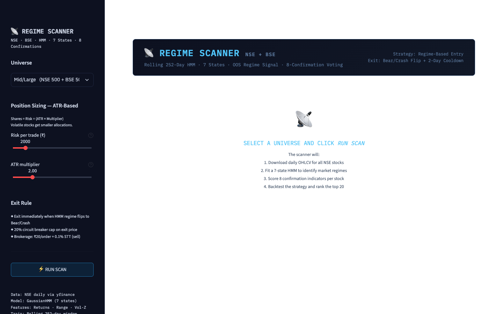

# NSE Regime Scanner

[](https://github.com/aadithyasumod/hmmmodel/actions/workflows/ci.yml)    

A Streamlit scanner that fits a walk-forward Hidden Markov Model to every stock in an NSE/BSE universe, takes long trades only in a Bull regime confirmed by 7 of 8 technical checks, and ranks the top 20 by backtested alpha, win rate and drawdown.



Every regime label used in the backtest is out-of-sample: the model for day *t* is trained only on the 252 trading days before it.

## What it does

- **Loads a universe** of NSE and BSE equities: Large Cap (NIFTY 50 + SENSEX 30, ~80 stocks), Mid/Large (NSE 500 + BSE 500, ~700) or All Markets (~6,800).
- **Downloads daily OHLCV** from Yahoo Finance in batches of 50 tickers.
- **Detects regimes** with a 7-state `GaussianHMM` on three winsorised features (daily return, high–low range ratio, 20-day volume z-score). The model is refit on a rolling 252-day window every 5 days; the state with the highest mean return is Bull, the lowest is Bear/Crash.
- **Confirms entries** only in a Bull regime with at least 7 of these 8 checks passing:

  | # | Check | Rule |
  |---|---|---|
  | 1 | RSI (14) | 40 < RSI < 75 |
  | 2 | Momentum | 20-day change > 1% |
  | 3 | Volatility | annualised < 50% |
  | 4 | Volume | above its 20-day SMA |
  | 5 | ADX (14) | > 25 |
  | 6 | Trend | close > EMA 50 |
  | 7 | Trend | close > EMA 200 |
  | 8 | MACD | MACD line > signal line |

- **Backtests** each stock: exit immediately on a Bear/Crash flip, 2-trading-day cooldown after any exit, exit price capped at the 20% circuit limit, ₹20 brokerage per order and 0.1% STT on sells.
- **Sizes positions by ATR**: shares = risk per trade ÷ (ATR × multiplier), defaults ₹2,000 and 2.0, capped at ₹1 lakh per position. Both are sidebar sliders.
- **Ranks** the top 20 with `score = 0.40 × alpha + 0.30 × win rate − 0.30 × max drawdown`, LONG signals above CASH, with equity-curve and regime-shaded price charts per stock.

## Architecture

```
app.py (Streamlit)
  universe_loader   NSE / BSE equity lists  ->  chosen universe
  scanner           8 parallel workers, 50-ticker yfinance batches
    data_loader     daily OHLCV
    hmm_engine      rolling 252-day GaussianHMM (7 states)  ->  Bull / Bear / Neutral per day
    indicators      RSI, momentum, volatility, volume, ATR, ADX, EMA 50/200, MACD  ->  8 confirmations
    backtester      regime + confirmations  ->  trades, equity curve, alpha, win rate, drawdown, Sharpe
  ->  top-20 table and per-stock charts
```

## Requirements

- Python 3.10+
- Network access to Yahoo Finance and the NSE/BSE equity lists

## Run locally

```bash
make setup        # python3 -m venv venv && pip install -r requirements.txt
make run          # streamlit run app.py  ->  http://localhost:8501
```

Pick a universe in the sidebar and click **Run scan**. Rough timings: Large Cap ~2 min, Mid/Large ~10 min, All Markets ~60 min.

| Command | What it does |
|---|---|
| `make setup` | create `venv/` and install requirements |
| `make run` | start the Streamlit app |
| `make test` | byte-compile every module |

## Project structure

```
app.py              Streamlit dashboard
universe_loader.py  NSE / BSE universes
data_loader.py      batched yfinance OHLCV download
hmm_engine.py       walk-forward 7-state HMM and regime labelling
indicators.py       technical indicators and the 8 confirmations
backtester.py       per-stock simulation, costs, ATR sizing, metrics
scanner.py          parallel scan and top-20 ranking
requirements.txt
Makefile
```

## Caveats

- A research and backtesting tool, not a live trading system and not investment advice.
- Yahoo data for small NSE/BSE stocks can have gaps; tickers with under 252 usable bars are skipped.
- Long-only; results ignore dividends, slippage and impact beyond the stated charges.

## License

Copyright © 2026 aadithyasumod. All rights reserved.

No license is granted. The code is published for reference: you may view it, but not use, copy, modify or distribute it without written permission.
